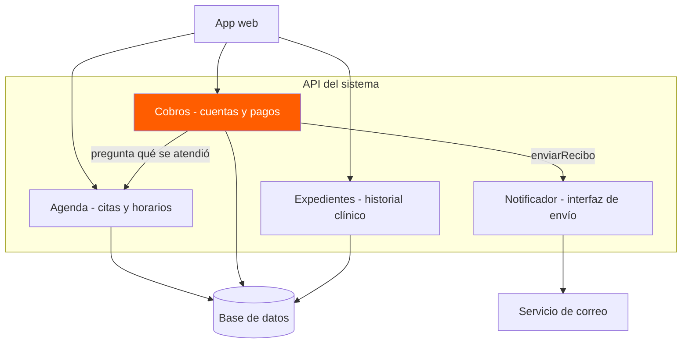
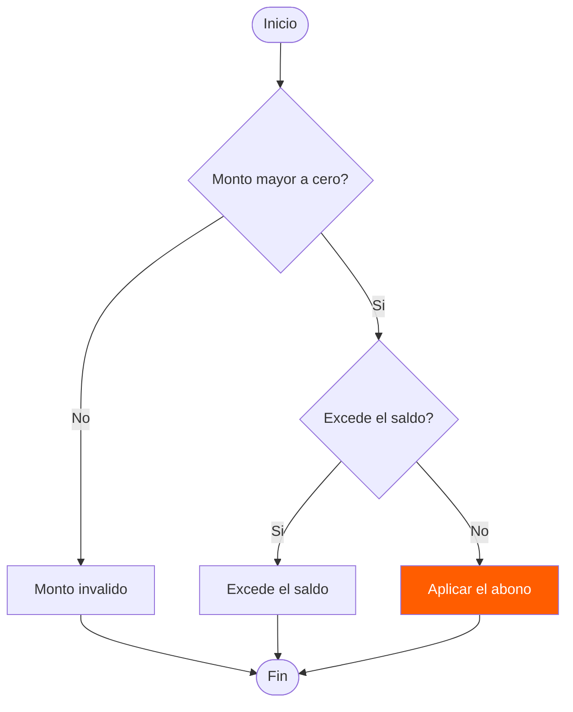
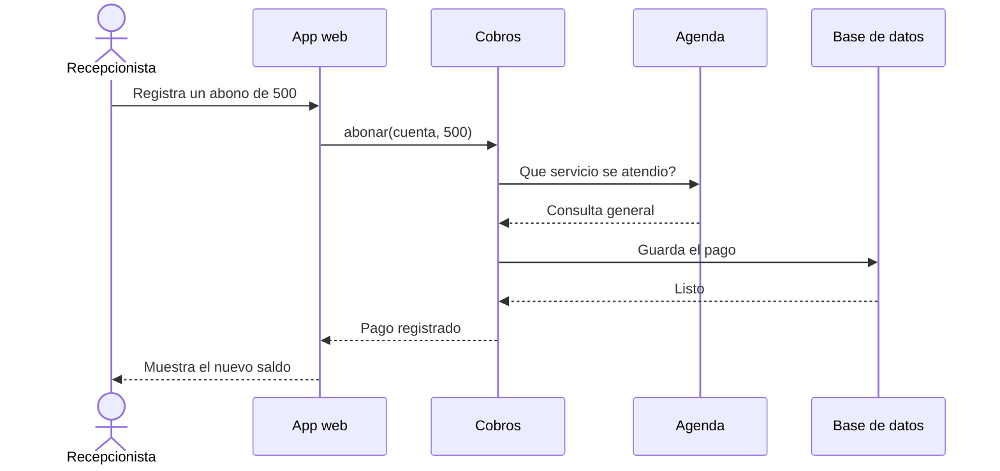
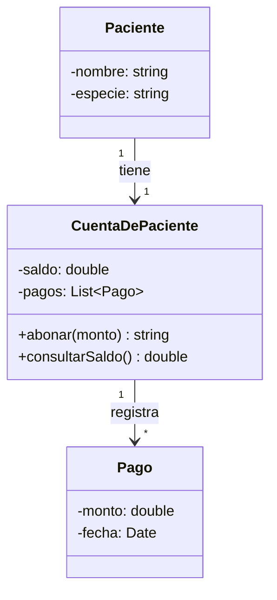
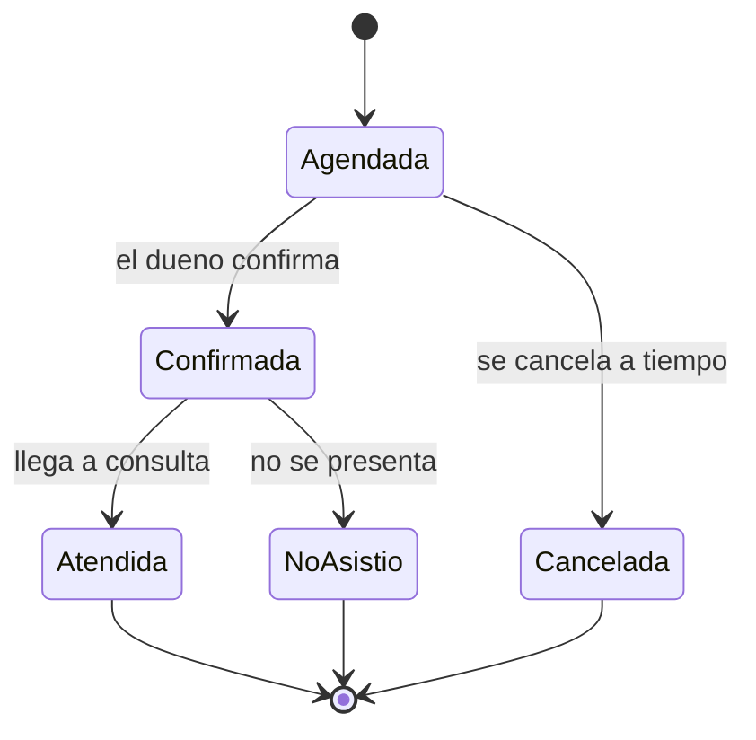
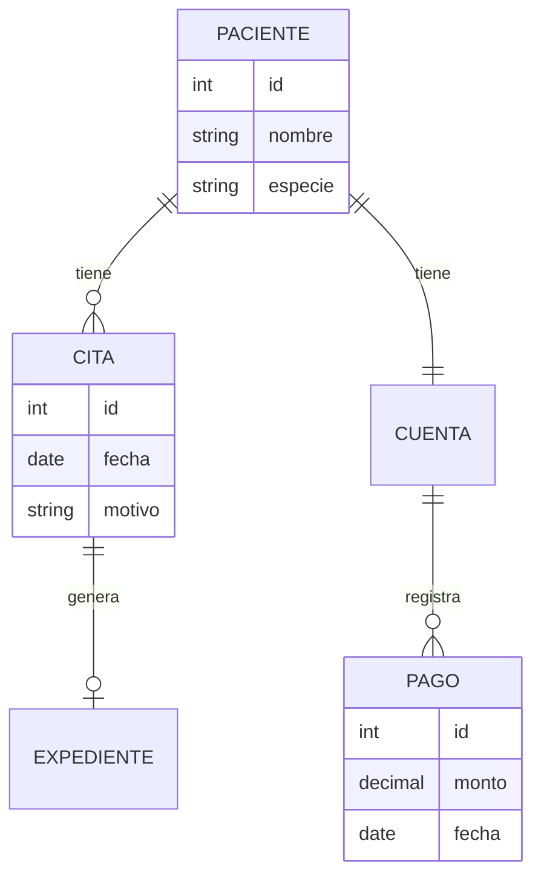

# Diagramas de arquitectura
## Ejercicio: Sistema de clínica veterinaria

En esta actividad se representan tres niveles de arquitectura de un sistema de clínica veterinaria mediante Mermaid. El objetivo es comprender cómo se relaciona el sistema con su entorno, cómo se organiza internamente y cuáles son las responsabilidades de sus componentes.

---

## Nivel 1. Diagrama de contexto

### Descripción
Este diagrama muestra el sistema de la clínica veterinaria como una sola unidad y su relación con los usuarios y servicios externos.

La recepcionista utiliza el sistema para agendar y cobrar consultas, mientras que el veterinario consulta los expedientes. Además, el sistema se comunica con un laboratorio externo para enviar estudios y con una pasarela de pagos para cobrar consultas.

### Diagrama

### Explicación
El diagrama de contexto permite identificar quién utiliza el sistema y con qué servicios externos se comunica, sin mostrar todavía las tecnologías ni su funcionamiento interno.

---

## Nivel 2. Diagrama de contenedores

### Descripción
Este diagrama muestra las principales partes tecnológicas del sistema de la clínica veterinaria.

La aplicación web está desarrollada con React, la API utiliza Node.js y la información se almacena en una base de datos PostgreSQL.

### Diagrama

### Explicación
La recepcionista utiliza la aplicación web, que se comunica con la API mediante HTTPS y JSON. La API consulta y actualiza la base de datos y también puede intercambiar información con el laboratorio externo mediante SFTP.

Este nivel permite comprender qué partes forman el sistema y cómo se comunican.

---

## Nivel 3. Diagrama de componentes

### Descripción
Este diagrama muestra los módulos que forman parte de la API del sistema y las responsabilidades de cada uno.

- Agenda: administra las citas y los horarios.
- Cobros: controla las cuentas y los pagos.
- Expedientes: maneja el historial clínico.
- Notificador: permite enviar información mediante un servicio de correo.

### Diagrama

### Explicación
La aplicación web se comunica con los módulos de la API según la operación que necesita realizar.

El módulo de Cobros consulta información de Agenda para conocer qué servicio se atendió y utiliza el Notificador para enviar recibos. Los módulos de Agenda, Cobros y Expedientes almacenan su información en la base de datos.

Este diagrama permite identificar las responsabilidades de cada módulo y las dependencias entre ellos.

---

## Nivel 4. Diagrama de flujo con decisiones

### Descripción

Este diagrama muestra el proceso para registrar un abono en la clínica veterinaria. Primero se verifica que el monto sea mayor a cero y después se comprueba que no exceda el saldo. Si cumple las condiciones, se aplica el abono.

### Diagrama Mermaid

### Explicación

Los rombos representan decisiones y las flechas indican los diferentes caminos que puede seguir el proceso dependiendo de las condiciones.

---

## Nivel 5. Diagrama de secuencia

### Descripción

Este diagrama muestra cómo se comunican la recepcionista, la aplicación web, el módulo de cobros, la agenda y la base de datos durante el registro de un abono.

### Diagrama Mermaid

### Explicación

El diagrama permite visualizar el orden en que se envían los mensajes entre los diferentes componentes del sistema, desde que se registra el abono hasta que se muestra el saldo actualizado.

---

## Nivel 6. Diagrama de clases

### Descripción

Este diagrama representa las clases Paciente, CuentaDePaciente y Pago, mostrando sus atributos, métodos y relaciones.

### Diagrama Mermaid

### Explicación

El diagrama muestra que cada paciente tiene una cuenta asociada y que una cuenta puede registrar varios pagos. También permite identificar los atributos y métodos de cada clase.

---

## Nivel 7. Diagrama de estados

### Descripción

Este diagrama representa los diferentes estados por los que puede pasar una cita veterinaria, desde que se agenda hasta que es atendida, cancelada o el paciente no se presenta.

### Diagrama Mermaid

### Explicación

El diagrama permite identificar los estados de una cita y los eventos que provocan que cambie de un estado a otro.

---

## Nivel 8. Diagrama entidad-relación

### Descripción

Este diagrama muestra las entidades principales de la base de datos de la clínica veterinaria y las relaciones entre pacientes, citas, cuentas, pagos y expedientes.

### Diagrama Mermaid

### Explicación

Este diagrama representa cómo se relacionan las entidades de la base de datos. También muestra algunos atributos de las tablas y la cardinalidad de sus relaciones.

---

## Conclusión general

La realización de estos ocho diagramas permitió comprender diferentes formas de representar un sistema de software. Cada diagrama tiene una función específica, desde mostrar la arquitectura general hasta explicar procesos, interacciones, clases, estados y relaciones entre los datos.

El uso de Mermaid facilitó la creación y documentación de los diagramas mediante código de texto, permitiendo visualizarlos directamente en GitHub.

