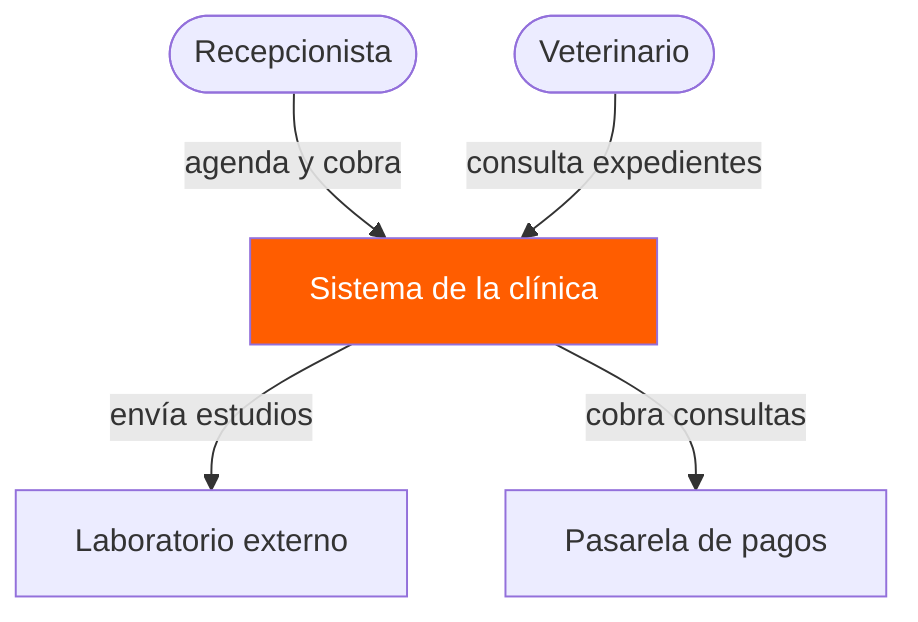
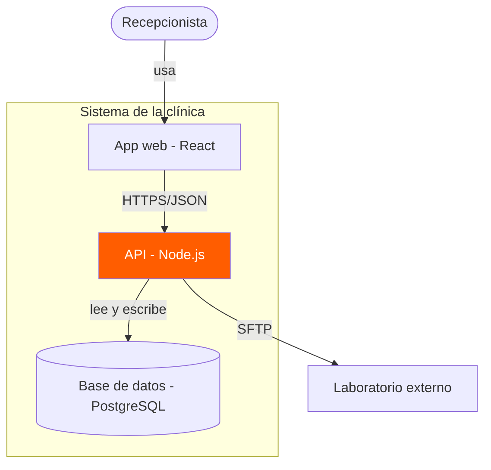
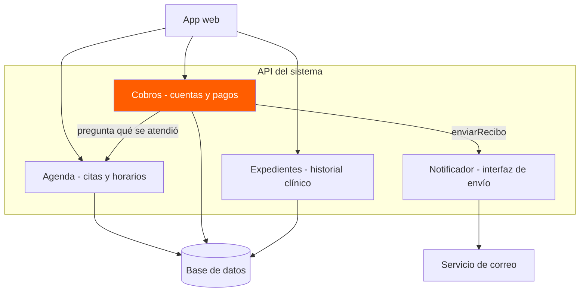

# Diagramas de arquitectura
## Ejercicio: Sistema de clínica veterinaria

En esta actividad se representan tres niveles de arquitectura de un sistema de clínica veterinaria mediante Mermaid. El objetivo es comprender cómo se relaciona el sistema con su entorno, cómo se organiza internamente y cuáles son las responsabilidades de sus componentes.

---

## Nivel 1. Diagrama de contexto

### Descripción
Este diagrama muestra el sistema de la clínica veterinaria como una sola unidad y su relación con los usuarios y servicios externos.

La recepcionista utiliza el sistema para agendar y cobrar consultas, mientras que el veterinario consulta los expedientes. Además, el sistema se comunica con un laboratorio externo para enviar estudios y con una pasarela de pagos para cobrar consultas.

### Diagrama

### Explicación
El diagrama de contexto permite identificar quién utiliza el sistema y con qué servicios externos se comunica, sin mostrar todavía las tecnologías ni su funcionamiento interno.

---

## Nivel 2. Diagrama de contenedores

### Descripción
Este diagrama muestra las principales partes tecnológicas del sistema de la clínica veterinaria.

La aplicación web está desarrollada con React, la API utiliza Node.js y la información se almacena en una base de datos PostgreSQL.

### Diagrama

### Explicación
La recepcionista utiliza la aplicación web, que se comunica con la API mediante HTTPS y JSON. La API consulta y actualiza la base de datos y también puede intercambiar información con el laboratorio externo mediante SFTP.

Este nivel permite comprender qué partes forman el sistema y cómo se comunican.

---

## Nivel 3. Diagrama de componentes

### Descripción
Este diagrama muestra los módulos que forman parte de la API del sistema y las responsabilidades de cada uno.

- Agenda: administra las citas y los horarios.
- Cobros: controla las cuentas y los pagos.
- Expedientes: maneja el historial clínico.
- Notificador: permite enviar información mediante un servicio de correo.

### Diagrama

### Explicación
La aplicación web se comunica con los módulos de la API según la operación que necesita realizar.

El módulo de Cobros consulta información de Agenda para conocer qué servicio se atendió y utiliza el Notificador para enviar recibos. Los módulos de Agenda, Cobros y Expedientes almacenan su información en la base de datos.

Este diagrama permite identificar las responsabilidades de cada módulo y las dependencias entre ellos.

---

## Conclusión

Los tres diagramas permiten analizar el mismo sistema desde diferentes niveles.

El diagrama de contexto muestra quién utiliza el sistema y sus conexiones externas. El de contenedores presenta las tecnologías y sus comunicaciones. Finalmente, el de componentes explica cómo se organizan las funciones dentro de la API.

Esta actividad ayuda a comprender cómo documentar una arquitectura antes de comenzar a desarrollar el software.
