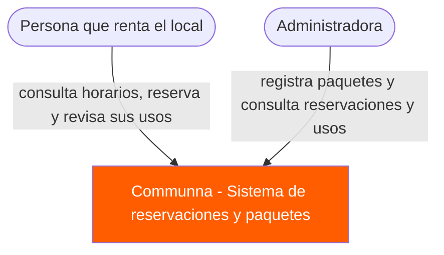
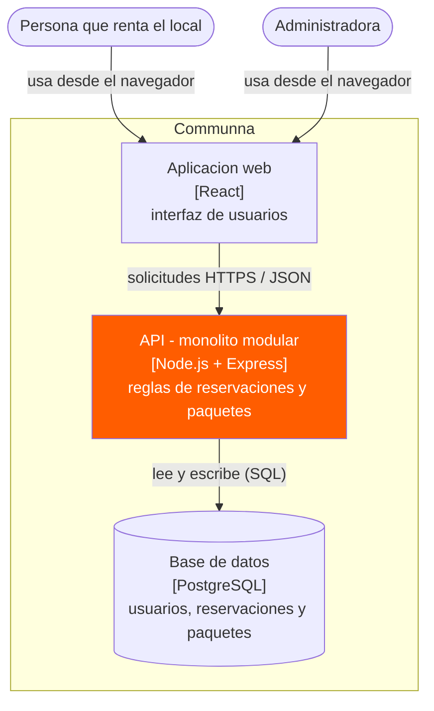
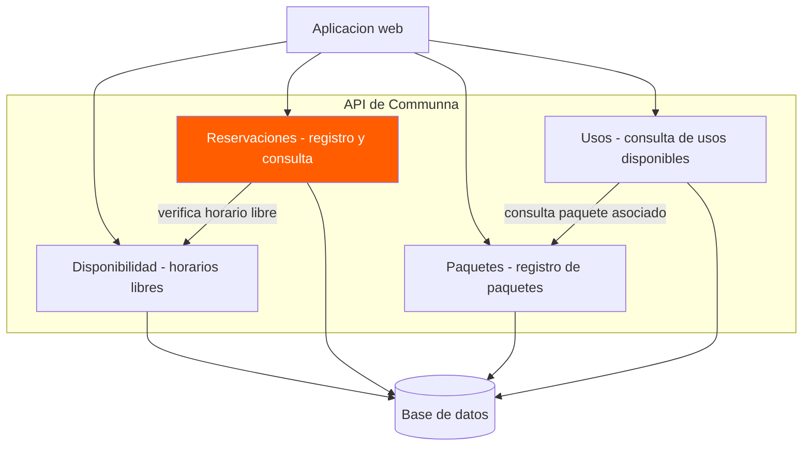
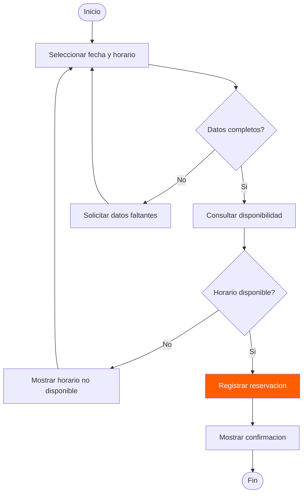
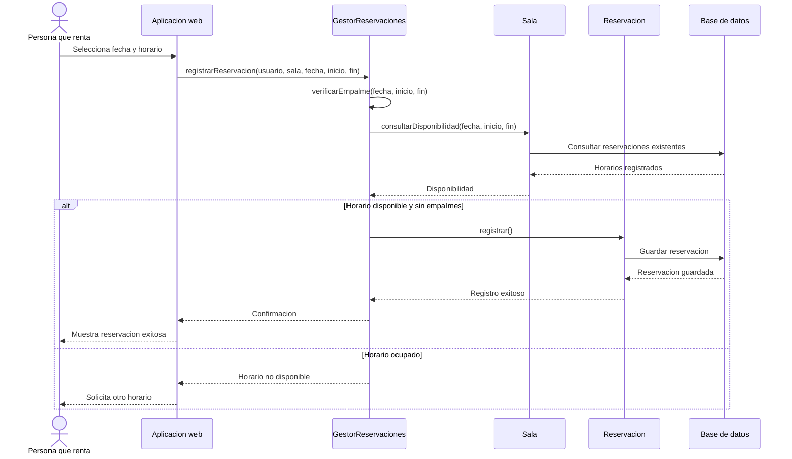
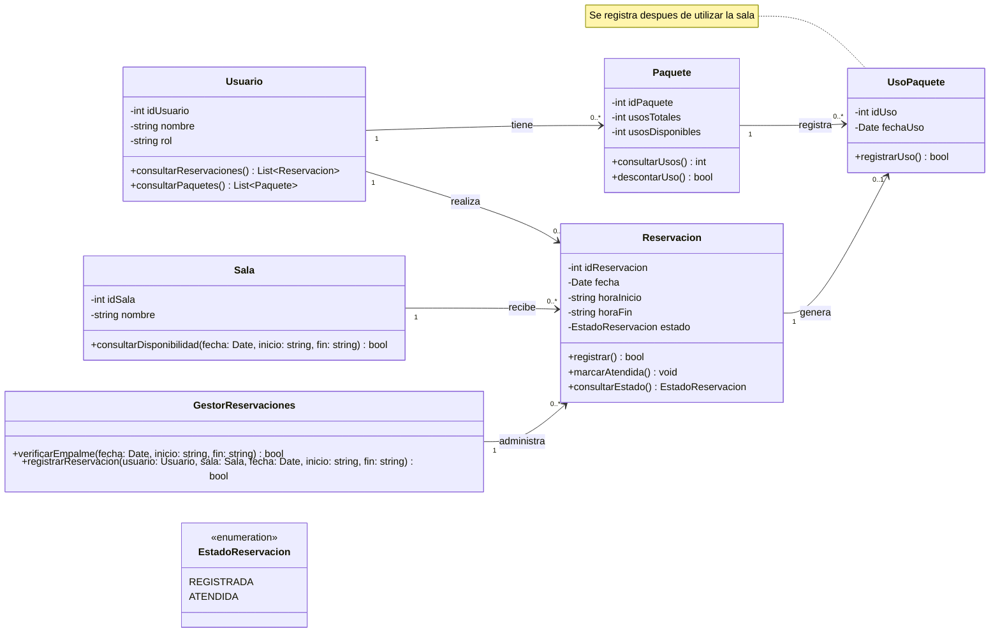
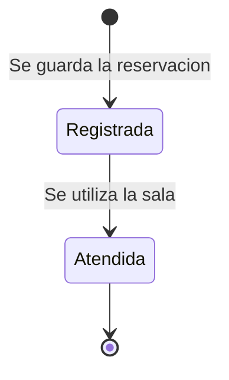
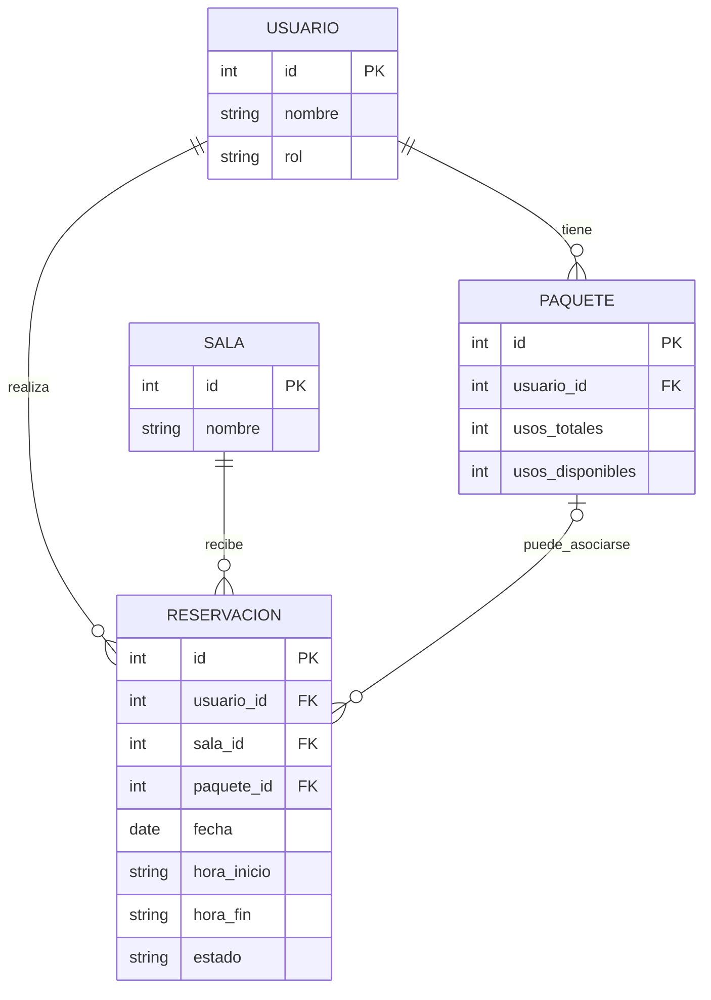

# Diagramas Mermaid — Communna

## Introducción

Communna es una propuesta de sistema web para administrar las reservaciones de una sala compartida y los paquetes de 5 o 10 usos. Busca facilitar la consulta de horarios, evitar reservaciones empalmadas y mostrar los usos disponibles de cada paquete.

> **Alcance de los diagramas:** Los diagramas describen una propuesta de diseño, no un sistema ya implementado. La arquitectura web/API/base de datos y el inicio de sesión por rol son decisiones propuestas que deben validarse con el equipo y el cliente. No se asumen reglas definitivas de cancelación ni de descuento de usos.

---

## 1. Diagrama de contexto

### Descripción

Presenta a Communna como un sistema único y a las dos personas que interactúan con él, las mismas que aparecen como actores en los casos de uso: la persona que renta el local y la administradora. La persona que renta consulta disponibilidad, reserva y revisa sus usos; la administradora registra paquetes y consulta reservaciones y usos.

### Explicación

El diagrama identifica a los usuarios principales y las funciones que realizan, sin entrar en detalles tecnológicos. Communna no se comunica con ningún sistema externo: los pagos, el correo y las notificaciones por WhatsApp quedaron fuera del alcance a propósito, y los avisos de paquete agotado (SC-001) se muestran dentro del propio sistema.

---

## 2. Diagrama de contenedores

### Descripción

Propone separar el sistema en una aplicación web, una API y una base de datos, cada una con su tecnología.

### Explicación

La aplicación web permite a los usuarios interactuar con Communna. La API procesa las solicitudes y verifica las reglas de negocio; la base de datos conserva la información. Es una arquitectura propuesta, no una implementación existente.

**Por qué estas tecnologías:** React y Node.js usan el mismo lenguaje (JavaScript) en la interfaz y en la API, lo que reduce lo que tiene que dominar un equipo pequeño. PostgreSQL es una base de datos relacional con transacciones, lo que ayuda a cumplir RF-003 (evitar empalmes) y RNF-CON-001 (usos disponibles siempre correctos), porque las reservaciones, los paquetes y los usos están relacionados entre sí.

---

## 3. Diagrama de componentes

### Descripción

Muestra los componentes propuestos dentro de la API: disponibilidad, reservaciones, paquetes y consulta de usos.

### Explicación

Antes de guardar una reservación, el módulo de reservaciones consulta la disponibilidad para evitar empalmes. Los módulos de paquetes y usos permiten registrar paquetes y conocer cuántos usos quedan. El momento exacto del descuento de un uso está pendiente de definir.

---

## 4. Diagrama de flujo con decisiones

### Descripción

Representa el proceso básico de registrar una reservación y comprobar que el horario solicitado no se encuentre ocupado.

### Explicación

Si faltan datos o el horario está ocupado, se solicita una corrección. Si la fecha y hora están disponibles, se registra la reservación y se muestra una confirmación.

---

## 5. Diagrama de secuencia

### Descripción

Representa el proceso de registrar una reservación en Communna. Muestra cómo el sistema verifica que no existan empalmes antes de guardar una nueva reservación.

### Explicación

La persona que renta selecciona una fecha y un horario. La aplicación web envía la solicitud a GestorReservaciones, que verifica si existe un empalme y consulta la disponibilidad de la sala.

Si el horario está disponible, se ejecuta la operación registrar() de la clase Reservacion y se guarda la información en la base de datos.

Si el horario está ocupado, el sistema solicita seleccionar otro.

### Consistencia con el diagrama de clases

Los mensajes registrarReservacion() y verificarEmpalme() corresponden a operaciones de GestorReservaciones. El mensaje consultarDisponibilidad() corresponde a la clase Sala y registrar() a la clase Reservacion.

Esto permite comprobar que las operaciones utilizadas en el diagrama de secuencia también están definidas en el diagrama de clases.

---

## 6. Diagrama de clases

### Descripción

El diagrama presenta las clases principales de Communna y sus relaciones. Incluye las operaciones necesarias para registrar reservaciones, verificar empalmes y controlar los usos de los paquetes. Es una propuesta de diseño que debe validarse con el cliente.

### Explicación

El diagrama representa las clases principales de Communna: Usuario, Sala, Reservacion, Paquete, UsoPaquete y GestorReservaciones, además de la enumeración EstadoReservacion.

GestorReservaciones se encarga de verificar que no existan empalmes antes de registrar una reservación.

La clase Paquete permite consultar los usos disponibles y descontar un uso cuando corresponde. La clase UsoPaquete registra cada utilización de la sala.

Una decisión importante es que los usos no se descuentan al realizar una reservación, sino después de que la sala haya sido utilizada. Esto permite conservar un registro de las reservaciones y controlar correctamente los paquetes.

La enumeración `EstadoReservacion` contiene solo los estados REGISTRADA y ATENDIDA, igual que el diagrama de estados. No se incluyen estados de cancelación ni de inasistencia porque esas reglas siguen pendientes de validar con la encargada.

**Patrón Controlador (GRASP):** `GestorReservaciones` recibe la solicitud desde la aplicación web y coordina las validaciones (verificar empalmes y consultar disponibilidad) antes de pedirle a `Reservacion` que se registre. Así la interfaz no contiene reglas de negocio y las validaciones quedan en un solo lugar. Esta clase se agregó al hacer el diagrama de secuencia: sin ella, no había una clase responsable de verificar empalmes entre varias reservaciones.

---

## 7. Diagrama de estados

### Descripción

Representa los estados propuestos para una reservación, se limita al registro y la atención; no se establecen reglas de cancelación porque todavía no están confirmadas.

### Explicación

Una reservación pasa a Registrada cuando se guarda en el sistema y a Atendida cuando se utiliza la sala. Son estados propuestos que deben revisarse con el cliente.

---

## 8. Diagrama entidad-relación

### Descripción

Presenta una propuesta inicial de tablas para almacenar usuarios, sala, reservaciones y paquetes. No representa todavía un diseño físico definitivo.

### Explicación

Un usuario puede registrar varias reservaciones y tener varios paquetes, una sala puede tener varias reservaciones en horarios distintos. La asociación entre reservación y paquete es opcional y está sujeta a confirmación.

---

## Conclusión

Estos ocho diagramas muestran distintas perspectivas de Communna: sus usuarios, la estructura tecnológica propuesta, sus componentes, el flujo de reservaciones, la comunicación interna, las clases, los estados y los datos. En conjunto ayudan a revisar el diseño antes de implementarlo y a detectar decisiones que todavía deben confirmarse con el cliente.
