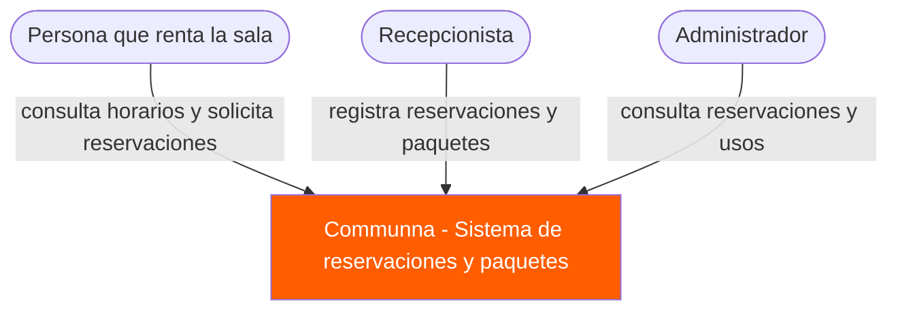
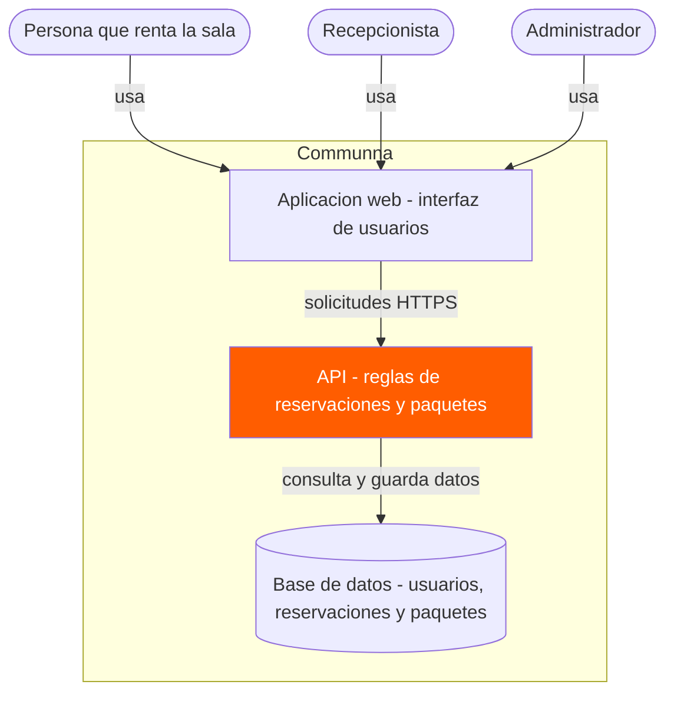
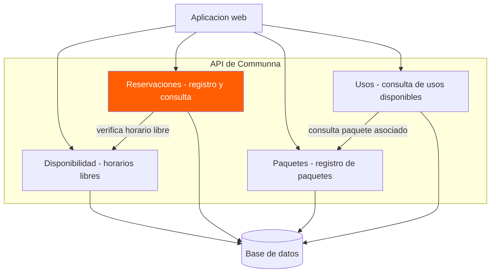
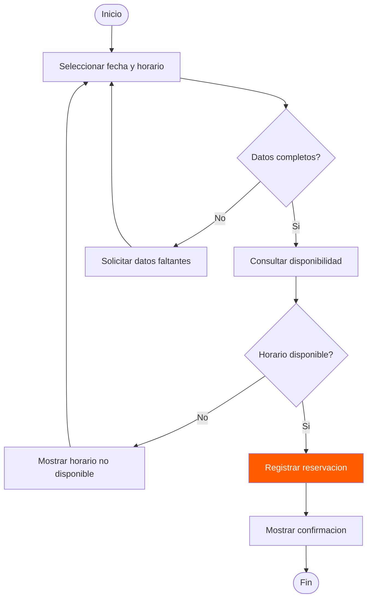
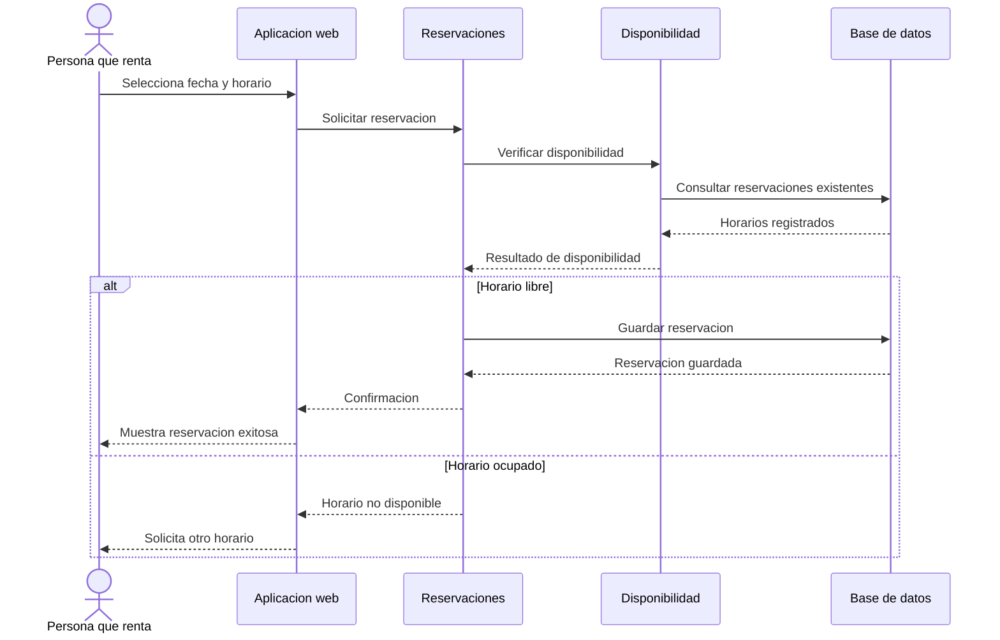
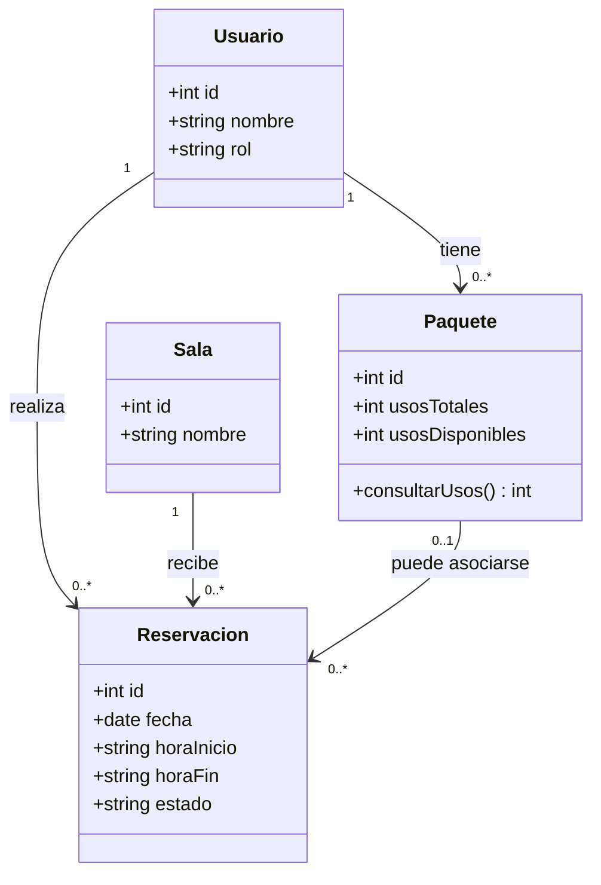
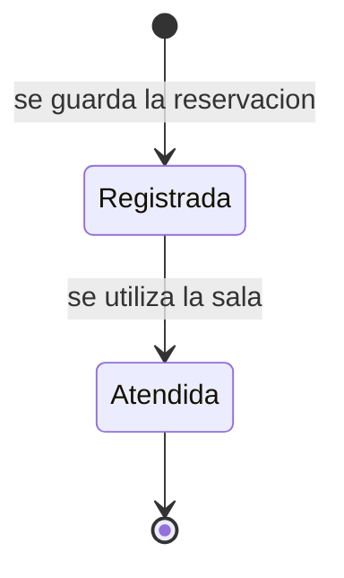
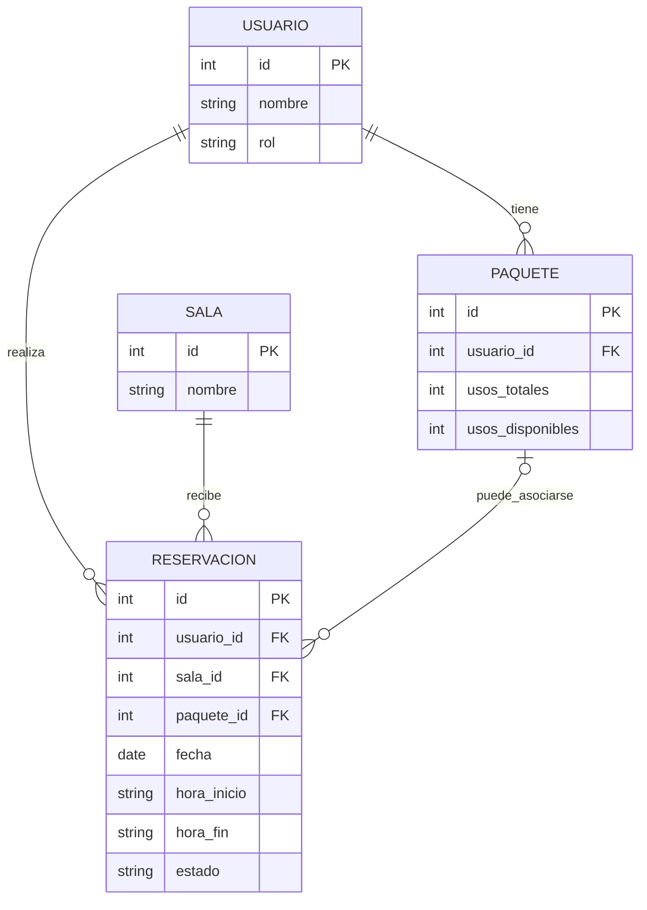

# Diagramas Mermaid — Communna

## Introducción

Communna es una propuesta de sistema web para administrar las reservaciones de una sala compartida y los paquetes de 5 o 10 usos. Busca facilitar la consulta de horarios, evitar reservaciones empalmadas y mostrar los usos disponibles de cada paquete.

> **Alcance de los diagramas:** Los diagramas describen una propuesta de diseño, no un sistema ya implementado. La arquitectura web/API/base de datos y el inicio de sesión por rol son decisiones propuestas que deben validarse con el equipo y el cliente. No se asumen reglas definitivas de cancelación ni de descuento de usos.

---

## 1. Diagrama de contexto

### Descripción

Presenta a Communna como un sistema único y a las personas que interactúan con él: la persona que renta la sala, la recepcionista y el administrador. La persona que renta consulta disponibilidad y solicita reservaciones; la recepcionista gestiona las reservaciones y paquetes; el administrador consulta la información general.

### Explicación

El diagrama identifica a los usuarios principales y las funciones que realizan, sin entrar en detalles tecnológicos. No se agregan servicios externos porque no forman parte del alcance confirmado.

---

## 2. Diagrama de contenedores

### Descripción

Propone separar el sistema en una aplicación web, una API y una base de datos. La tecnología específica aún no está definida.

### Explicación

La aplicación web permite a los usuarios interactuar con Communna. La API procesa las solicitudes y verifica las reglas de negocio; la base de datos conserva la información. Es una arquitectura propuesta, no una implementación existente.

---

## 3. Diagrama de componentes

### Descripción

Muestra los componentes propuestos dentro de la API: disponibilidad, reservaciones, paquetes y consulta de usos.

### Explicación

Antes de guardar una reservación, el módulo de reservaciones consulta la disponibilidad para evitar empalmes. Los módulos de paquetes y usos permiten registrar paquetes y conocer cuántos usos quedan. El momento exacto del descuento de un uso está pendiente de definir.

---

## 4. Diagrama de flujo con decisiones

### Descripción

Representa el proceso básico de registrar una reservación y comprobar que el horario solicitado no se encuentre ocupado.

### Explicación

Si faltan datos o el horario está ocupado, se solicita una corrección. Si la fecha y hora están disponibles, se registra la reservación y se muestra una confirmación.

---

## 5. Diagrama de secuencia

### Descripción

Muestra los mensajes entre la persona que renta, la aplicación web, los módulos de reservaciones y disponibilidad, y la base de datos al crear una reservación.

### Explicación

El sistema consulta los horarios existentes antes de guardar una nueva reservación. El diagrama también muestra qué ocurre cuando el horario solicitado ya está ocupado.

---

## 6. Diagrama de clases

### Descripción

Propone las clases principales para representar a las personas usuarias, las reservaciones, la sala y los paquetes. Sus atributos y operaciones son orientativos.

### Explicación

Una persona puede tener varias reservaciones y paquetes. Cada reservación corresponde a una sala. La relación opcional con el paquete representa una propuesta de diseño que debe validarse según cómo se registren y descuenten los usos.

---

## 7. Diagrama de estados

### Descripción

Representa los estados propuestos para una reservación. Se limita al registro y la atención; no se establecen reglas de cancelación porque todavía no están confirmadas.

### Explicación

Una reservación pasa a Registrada cuando se guarda en el sistema y a Atendida cuando se utiliza la sala. Son estados propuestos que deben revisarse con el cliente.

---

## 8. Diagrama entidad-relación

### Descripción

Presenta una propuesta inicial de tablas para almacenar usuarios, sala, reservaciones y paquetes. No representa todavía un diseño físico definitivo.

### Explicación

Un usuario puede registrar varias reservaciones y tener varios paquetes. Una sala puede tener varias reservaciones en horarios distintos. La asociación entre reservación y paquete es opcional y está sujeta a confirmación.

---

## Conclusión

Estos ocho diagramas muestran distintas perspectivas de Communna: sus usuarios, la estructura tecnológica propuesta, sus componentes, el flujo de reservaciones, la comunicación interna, las clases, los estados y los datos. En conjunto ayudan a revisar el diseño antes de implementarlo y a detectar decisiones que todavía deben confirmarse con el cliente.
